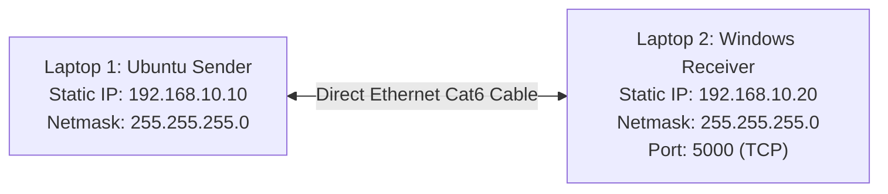

# Two-Laptop Telemedicine Setup & Cross-Platform Verification Guide

**Project**: Network-Aware Adaptive Compression for Breast Ultrasound Image Transmission and Deep Learning-Based Lesion Segmentation  
**Hardware Configuration**:
- **Laptop 1 (Sender / Field Node)**: Ubuntu Linux (22.04 / 24.04 LTS)
- **Laptop 2 (Receiver / Server Node)**: Windows 11 (64-bit)
- **Physical Interconnect**: Direct Cat6 / Cat5e Ethernet cable or isolated Gigabit switch.

---

## 1. Network Topology & Static Addressing

For reliable physical network emulation without DHCP router interference, configure static IP addresses on both laptops.



| Parameter | Laptop 1 (Ubuntu Sender) | Laptop 2 (Windows Receiver) |
|-----------|--------------------------|-----------------------------|
| **IP Address** | `192.168.10.10` | `192.168.10.20` |
| **Subnet Mask** | `255.255.255.0` (`/24`) | `255.255.255.0` (`/24`) |
| **Default Gateway** | `192.168.10.1` (or blank) | `192.168.10.1` (or blank) |
| **TCP Port** | Client ephemeral outgoing | `5000` (Listening) |

---

## 2. Step-by-Step Configuration Procedures

### A. Laptop 2: Windows Receiver Configuration

1. **Identify Ethernet Interface Name**:
   Open PowerShell as Administrator:
   ```powershell
   Get-NetAdapter | Where-Object Status -eq "Up"
   ```
   Note the name (typically `"Ethernet"`).

2. **Configure Static IP Address**:
   ```powershell
   New-NetIPAddress -InterfaceAlias "Ethernet" -IPAddress "192.168.10.20" -PrefixLength 24
   ```

3. **Configure Windows Defender Firewall for TCP Port 5000**:
   Allow inbound TCP traffic on port 5000:
   ```powershell
   New-NetFirewallRule -DisplayName "Telemedicine Receiver Port 5000" `
                       -Direction Inbound `
                       -Protocol TCP `
                       -LocalPort 5000 `
                       -Action Allow `
                       -Profile Any
   ```

4. **Launch Receiver Application**:
   ```powershell
   .\venv\Scripts\python.exe -m receiver.app
   ```
   - In the Receiver GUI, ensure Server status indicates **Listening on 0.0.0.0:5000**.
   - Check that the U-Net model is loaded (`models/best_unet_mgda.pth`).

---

### B. Laptop 1: Ubuntu Sender Configuration

1. **Identify Ethernet Interface Name**:
   ```bash
   ip -o link show
   ```
   Identify the Ethernet port name (e.g. `eth0` or `enp3s0`).

2. **Assign Static IP Address via `iproute2` or NetworkManager**:
   ```bash
   sudo ip addr flush dev enp3s0
   sudo ip addr add 192.168.10.10/24 dev enp3s0
   sudo ip link set enp3s0 up
   ```

3. **Verify Firewall on Ubuntu (ufw)**:
   ```bash
   sudo ufw status
   # If ufw is active, allow outgoing and verify traffic:
   sudo ufw allow out 5000/tcp
   ```

4. **Launch Sender Application**:
   ```bash
   python3 -m sender.app
   ```
   - In the Transmission tab, set **Receiver Host/IP** to `192.168.10.20`, Port `5000`.

---

## 3. End-to-End Link Verification Checklist

Run these commands in order before executing any research experiments:

- [ ] **Step 1: Physical Link Check**:
  - Ubuntu: `ethtool enp3s0 | grep "Link detected"` $\implies$ Should output `yes`.
  - Windows: `Get-NetAdapter -Name "Ethernet"` $\implies$ Status should be `Up`.
- [ ] **Step 2: Bidirectional Ping Verification**:
  - From Ubuntu: `ping -c 4 192.168.10.20` $\implies$ $0\%$ packet loss, RTT $< 1.0\text{ ms}$.
  - From Windows: `ping -n 4 192.168.10.10` $\implies$ $0\%$ packet loss, RTT $< 1.0\text{ ms}$.
- [ ] **Step 3: Port 5000 Connectivity Probe**:
  - From Ubuntu terminal: `nc -zv 192.168.10.20 5000` $\implies$ `Connection to 192.168.10.20 5000 port [tcp/*] succeeded!`
  - Or click the **Probe Receiver** button in the Sender GUI.
- [ ] **Step 4: Image Transfer & Checksum Verification**:
  - Select a test image in Sender GUI.
  - Choose Option A (Normal JPEG) or Option B (Region-Adaptive).
  - Click **Send Active Image Frame**.
  - Verify that Receiver confirms SHA-256 and replies with `ACK_OK`.
  - Verify that U-Net executes inference and returns segmentation metrics.

---

## 4. Troubleshooting Guide for Direct Connection Issues

| Symptom | Probable Cause | Diagnostic Command | Remediation Action |
|---------|----------------|--------------------|--------------------|
| **Ping fails (Destination Unreachable)** | Subnet mismatch or interface down | `ip addr` (Ubuntu) / `ipconfig` (Windows) | Ensure both are in `192.168.10.0/24` subnet and Ethernet adapters are enabled. |
| **Ping succeeds but Probe fails** | Windows Firewall blocking port 5000 | `Test-NetConnection -Port 5000` (Windows) | Run the firewall rule command in Section 2A, step 3. |
| **`tc qdisc` command permission denied** | Non-root execution on Ubuntu | `sudo tc qdisc show` | Ensure user is in sudoers or launch sender with appropriate permissions. |
| **Checksum Mismatch on Receiver** | Network adapter hardware offload corruption | Receiver log shows `ACK_CHECKSUM_MISMATCH` | Disable TCP Large Receive Offload (LRO) or Checksum Offload on physical NIC: `sudo ethtool -K enp3s0 rx off tx off`. |
| **Socket Connection Timeout** | Sleep / power saving on Windows NIC | Windows Device Manager | Disable "Allow the computer to turn off this device to save power" on the Ethernet controller. |
